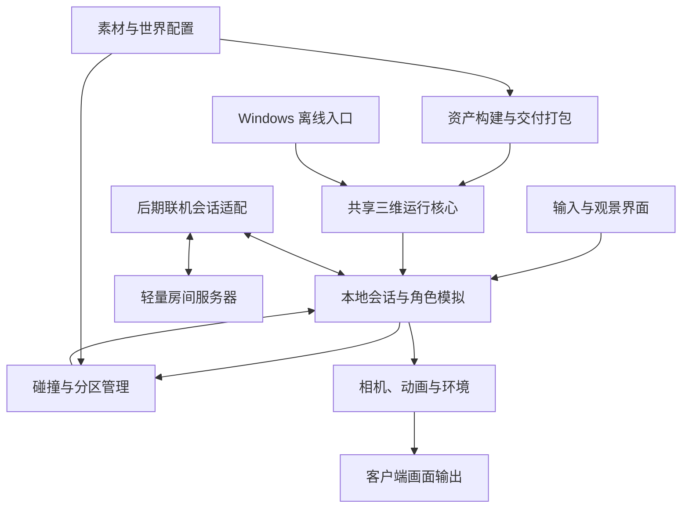
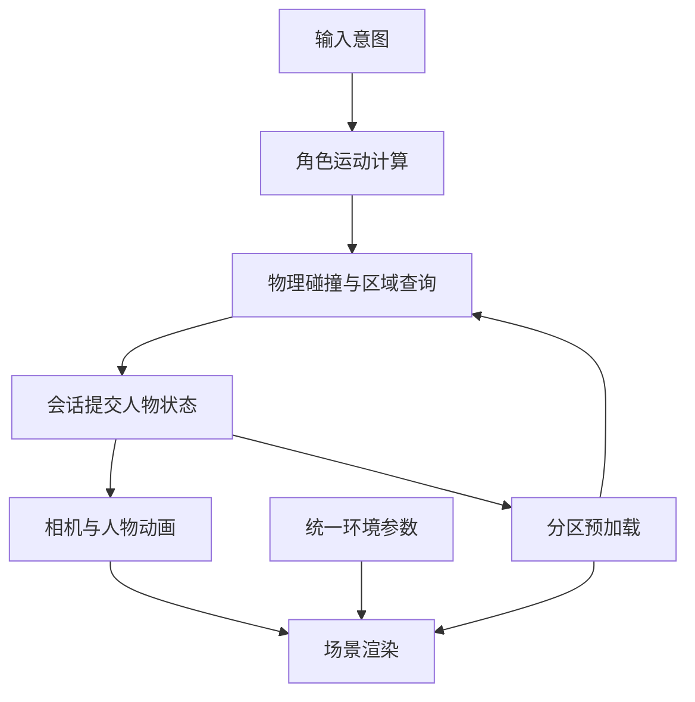
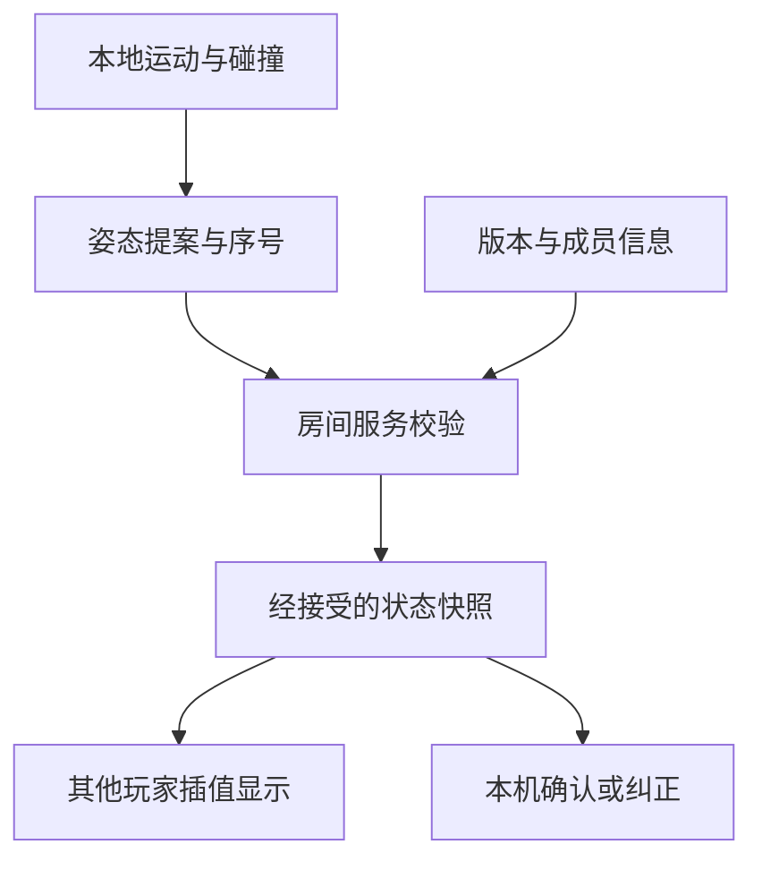

# 天宫与江南三维观景世界 · 整体技术架构设计

| 项目 | 内容 |
| --- | --- |
| 版本 | v1.0 · 架构审核稿 |
| 日期 | 2026-10-21（北京时间） |
| 产品依据 | D:\AI\项目\make HTML\tiangong-product-requirements-v1.0.md（本轮已读取） |
| 本轮交付 | 架构、模块职责、数据流、阶段划分、风险与技术方案比较 |
| 本轮未开展 | 业务编码、项目初始化、依赖安装、素材下载、部署 |

本文中的技术栈、阶段切分、技术参数均为**设计建议**，不是用户已确认的新增产品需求。PRD 的 U-01—U-18 未定问题保持未定。批准架构不自动等于批准首版全部功能或启动实现。

## 1. 整体架构

### 1.1 推荐方案

推荐采用**一套模块化浏览器三维核心、两种离线打包方式、后期接入轻量联机服务**。

推荐技术组合：

- TypeScript：组织角色、世界、环境和状态逻辑。
- Babylon.js：负责三维场景、材质、光影、动画与画面输出。
- Rapier 3D：负责角色碰撞、地面查询、重力运动所需的碰撞求解。
- Vite：构建开发工程及标准分发包；单文件 HTML 需要单独的打包配置与验证。
- GLB/glTF 2.0：作为主要运行模型交换格式；完整项目按需加入 KTX2 纹理。
- 轻量 HTML/CSS 界面：提供观景所需控制，不额外引入大型界面框架。
- 后期 Node.js + Colyseus：维护 3—5 人房间与状态；不是第一阶段依赖。

这是一项适配两种离线交付和后期联机的工程推荐，不代表该组合能自动达到参考图画质或 60 FPS。Babylon.js 官方列有场景图、PBR、动画及 WebGL/WebGPU 等能力 [R1]；Rapier 提供运动学角色控制及碰撞查询 [R2]。

### 1.2 系统边界图

图中素材到分区的箭头表示逻辑内容依赖；运行时必须通过本机交付的资产访问层读取，不直接访问开发机器路径。图中的后期联机节点在离线版不加载、不连接。

### 1.3 三个交付版本的关系

| 版本 | 建议形态 | 复用关系 | 审核边界 |
| --- | --- | --- | --- |
| A：简易离线 HTML | 精简内容、内嵌运行库和必需资源的 HTML；优先验证直接打开可用 | 与 B 共用角色、相机、物理、世界配置和基础渲染逻辑 | 单文件与直接双击是建议，PRD 尚未强制；功能子集待确认 |
| B：完整离线项目 | 生产构建文件、模型素材目录及便携本地启动入口 | 同一工程增加场景与资源配置，不重写为另一套引擎 | 建议通过本地回环 HTTP 读取文件；需审核是否接受 |
| C：后续联机 | B 的客户端增加联机会话适配，另部署小型房间服务 | 复用资产、人物、模拟与渲染 | 后期实施，服务器能力需实测 |

推荐**共享一个工程、输出不同内容包**，而不是长期维护两套独立游戏。A 包简化资产与特效，不用另一套临时碰撞规则取代共用核心。

如果后续认定完整版本必须是原生 Windows 游戏，可重新比较 Godot 等方案；这会影响代码复用与开发流程，不能在 A 完成后默默切换。

### 1.4 执行边界

| 所在位置 | 职责 | 不承担的工作 |
| --- | --- | --- |
| 用户电脑 | 输入、角色模拟、碰撞、资产读取、动画、相机、环境和渲染 | 离线模式不请求云端服务 |
| 开发云端 | 源码维护、构建、资产加工、自动检查和功能验证 | 不把云端跑分当成用户电脑性能 |
| 后期两核 2 GB 服务器 | 房间、连接、有限状态校验和广播 | 不渲染画面，不承载完整美术场景，不运行云游戏视频推流 |

## 2. 架构原则与重要边界

1. **一处写入人物状态。** 输入、相机、动画和网络不能各自修改人物位置。
2. **模型不等于碰撞体。** 精细瓦片和雕刻用于画面，地板、墙、楼梯和屋顶使用独立简化碰撞。
3. **建筑大小不等于模型复杂度。** 通过实际比例、远近层次及模块复用表现宏大，避免靠无上限面数。
4. **世界分区是三维的。** 地面、上升通道、云海和天宫具有垂直关系，不能只按地面二维距离加载。
5. **离线是完整依赖闭环。** 脚本、物理 WASM、模型、字体、贴图及解码器必须随包或内嵌。
6. **保留后期联机接口，不提前部署联机系统。**
7. **关键体验与性能先验证。** 先验证建筑尺度、自由移动、屋顶和室内，再大量铺设宫殿。
8. **保留 PRD 的不确定性。** 水中活动、天气种类和运动规则不由技术设计代替用户决定。

## 3. 核心模块与职责

以下为逻辑模块，不意味着每个模块都需要独立服务、独立进程或大型抽象框架。

| 编号 | 模块 | 职责 | 主要输入 | 主要输出 | 边界／对应 PRD |
| --- | --- | --- | --- | --- | --- |
| M01 | 启动与运行配置 | 初始化依赖、能力检测、选择 A/B 内容配置、错误提示、运行生命周期 | 包配置、设备能力 | 运行上下文、就绪状态 | 不连接联机服务；C-11 |
| M02 | 输入与操作意图 | 将键鼠等操作转为移动、飞行、视角与互动意图 | 原始输入 | PlayerIntent、视角／互动命令 | 不直接移动人物；C-04—C-06 |
| M03 | 本地会话与状态 | 管理唯一当前会话、人物状态、交互对象状态和逻辑时间 | 命令、模拟结果 | 可供读取的状态快照 | 第一阶段只有 LocalSession；为后期留替换点 |
| M04 | 角色运动 | 依状态与参数计算期望位移，处理地面、飞行、坠落及水域模式 | 意图、上一状态、区域信息 | 期望位移、移动状态 | 水中具体模式待定；C-04、C-05、C-09、C-10 |
| M05 | 物理与场景查询 | 角色碰撞、支撑面、坡阶、路径扫掠及相机遮挡查询 | 期望位移、碰撞体 | 安全位移、接触与查询结果 | 通过适配层使用 Rapier；不使用第二套独立移动碰撞系统 |
| M06 | 世界与分区 | 地面、天宫、室内、水域的空间组织、激活与卸载、稳定对象编号 | 世界清单、人物位置、观察方向 | 活跃区域、碰撞就绪状态 | 不负责下载源素材；C-01、C-03、C-07、C-08 |
| M07 | 资产访问与缓存 | 按清单读取、去重、缓存、取消、引用计数和释放资源 | 资产编号、优先级、访问模式 | 可用模型、纹理、动画及失败信息 | 支持内嵌／本地 HTTP，不能在业务中硬写 CDN |
| M08 | 角色外观与动画 | 将移动状态映射为临时古装模型和基本动画 | 人物快照、动作事件 | 人物姿态与模型变换 | 动画不反向改变真实位置；C-04 |
| M09 | 相机 | 第一／第三人称、观察方向、镜头阻挡处理 | 人物快照、视角命令、空间查询 | 相机姿态 | 相机不是可独立改变角色位置的自由飞行器；C-06 |
| M10 | 渲染与性能 | PBR、灯光、阴影、水面、LOD、实例化、帧指标和效果档位 | 场景、相机、环境参数 | 每帧画面与性能记录 | Babylon.js 专属对象尽量止于此层及资产适配边界；C-01、C-02、Q-01 |
| M11 | 环境状态与表现 | 统一管理光景参数，后续驱动昼夜、天气、星空、银河和月亮 | 环境配置、逻辑时间 | 光照、天空、云雾等参数 | 第一阶段仅需固定光景，不自动开发全部天气；S-04—S-06 |
| M12 | 互动与观景界面 | 关门、坐下、截图的命令入口、提示和界面 | 用户命令、可交互对象 | 互动请求、截图请求、界面状态 | 业务状态归 M03；截图只读取画面；S-01—S-03 |
| M13 | NPC 与音频扩展 | 后续简单 NPC 和可能的音乐／环境声 | 已确认扩展配置 | NPC 表现、音频 | 不在第一阶段实现复杂 AI；S-07、D-02 |
| M14 | 联机会话适配与房间服务 | 后期连接、状态快照、远端人物、版本检查和连接生命周期 | 本地提案、服务器快照 | 远端视图、经校验会话状态 | 不把渲染引擎移到服务器；D-01 |
| M15 | 资产制作与构建检查 | 规范模型比例、纹理、LOD、碰撞代理、许可来源记录和打包完整性 | 原始模型、配置、工程 | GLB、清单、内容包与检查记录 | 开发工具链，不在游玩时执行 |

依赖关系采用明确调用和少量事件。第一阶段不引入通用 ECS 框架、全局事件总线、数据库或微服务。

## 4. 模块之间的数据流

### 4.1 一次移动及一帧显示

推荐执行次序：

1. 启动器先加载物理与出生区域必需资产；碰撞未就绪不能进入可操作状态。
2. 每个模拟步读取输入意图，计算人物期望运动。
3. 查询区域、水域和碰撞约束，得到可接受位移；提交到会话状态。
4. 相机与动画读取提交后的状态。人物动画的根位移不作为另一套运动权威。
5. 分区模块根据位置、速度和观察方向预取资源；异步任务的结果在安全边界接入。
6. 渲染循环读取模拟快照并插值显示；渲染速度与物理步长分开。
7. 环境模块提供统一光照和时间参数，不让天空、建筑和水面分别维护自己的时钟。

建议模拟采用固定步长，初始评估 60 Hz；渲染使用浏览器逐帧回调。该数值为技术起点，不是联机发送频率，也不是已经满足 60 FPS。后台暂停、单次长卡顿需限制补算步数，避免无限追帧。

### 4.2 核心数据及所有权

下表为数据设计，不是代码或最终接口定义。

| 数据 | 主要内容 | 写入方 | 读取方 |
| --- | --- | --- | --- |
| PlayerIntent | 方向、飞行相关意图、动作请求、命令序号 | 输入模块；后期网络接收适配 | 运动、会话 |
| PlayerState | 稳定编号、逻辑位置、朝向、速度、运动模式、支撑状态、逻辑步号 | 会话提交运动结果 | 相机、动画、分区、网络 |
| WorldManifest | 世界版本、区域边界、模型引用、碰撞引用、LOD 与入口信息 | 资产构建流程 | 世界、资产访问 |
| ObjectState | 对象编号及已经确认的互动状态 | 离线会话；后期按同步范围由服务器维护 | 互动、场景表现 |
| EnvironmentState | 光景预设；后期逻辑时间和天气状态 | 环境／会话 | 渲染、天空、水面；后期网络 |
| AssetRegistry | 资源编号、路径或内嵌键、依赖、版本及哈希 | 构建流程 | 资产访问、兼容性检查 |
| RenderSnapshot | 可显示人物与对象姿态 | 会话与显示适配 | 渲染、动画、相机 |
| NetworkSnapshot | 房间步号、成员状态、版本信息 | 后期房间服务器 | 联机会话、远端表现 |

运动状态在架构上需要可表达地面、飞行、空中坠落及水域活动；是否进一步拆出涉水、游泳、潜水，必须等 PRD U-09 的答案。坐下状态与运动的互斥规则也待用户确认。

建议统一长度单位为米、Y 轴向上，在资产导入处统一左右手坐标；这些只是技术规范，不决定建筑有多少米。世界位置与渲染位置保留转换入口，以便确有精度问题时再引入浮动原点。

### 4.3 区域流转

**位置与速度 → 区域需求预测 → 资产访问 → 模型／纹理解码 → 碰撞准备 → 区域可进入 → 精细画面接入。**

关键规则：

- 可以让远处建筑先显示粗略轮廓，但玩家附近必须有可靠碰撞。
- 地板、屋顶和入口的碰撞就绪，是允许进入对应可达区域的前提。
- 在载入目标区域前保留当前位置的支撑碰撞；不能先卸载再等新地板。
- 快速飞行按前进方向和速度提前加载，不能只靠当前位置。
- 异步加载带代次标识；玩家转向或离开后，旧任务不能把过时资源重新接入场景。
- 资源共享引用计数，分区卸载不能误删仍被其他宫殿使用的纹理。
- 如果加载赶不上，建议短暂限制进入未就绪区域并提示；是否接受可见等待属于 U-07，需审核，不能暗自以穿模代替。
- 加载调度是开发能力，不等于用户已经批准任何具体等待界面。

### 4.4 互动与截图

- 关门：输入请求 → 选中对象编号 → 会话处理 → 对象状态变化 → 门模型与碰撞同步更新。
- 坐下：请求 → 会话根据已确认规则处理 → 动作状态 → 人物表现。
- 截图：请求 → 在已完成一帧画面后导出 → 本地图片。是否隐藏界面、格式与清晰度待定。
- 门若暂不可交互，不能仅让渲染模型关闭而碰撞仍保持打开。
- 不为截图默认常开高成本画面保留功能；若普通帧导出不可靠，可在截图时单独执行显示渲染，具体方案由兼容性验证决定。

## 5. 场景、资产与渲染结构

### 5.1 世界结构

建议在同一逻辑世界内组织地面、空中路径、天宫群、宫殿室内及水域。

- 采用有边界的分区清单，不构造无限世界。
- 分区按空间范围与场景内容组织，既考虑水平也考虑高度。
- 室内可独立调度，但不自动改成必须传送进入的独立关卡。
- 初始用简单空间网格或包围盒索引；数据规模证明需要时再增加复杂空间结构。
- 地面 6—8 分钟在步行速度与路线确认后换算，架构不预设地图公里数。
- 宏大建筑保持远景轮廓层；玩家接近时再加载可看细节与可通行区域。
- 浮动原点不列为第一阶段必做：先测试目标高度和深度精度；如需要，其转换只影响显示／物理局部坐标，联网仍使用统一逻辑坐标。

### 5.2 建筑资产

建议由重复构件与重点地标组合：

- 柱、栏杆、台阶、屋檐等重复件采用分区内实例化。
- 门、座位及需要单独交互的对象保持稳定编号和独立状态。
- 重点建筑轮廓和近看雕刻需要专门资产，不能假设免费现成模型全部匹配。
- 高细节模型配独立简化碰撞、远景模型和合适贴图。
- 一组 thin instances 按空间分区分组，不能把整个世界的栏杆放进同一组；官方指出同组 thin instances 具有整体显示／隐藏特征 [R4]。
- 不直接将江南旧 WebGL 渲染器嵌入新引擎同时运行；提取元素参考，必要时转换其构型或重建资产。

### 5.3 画面策略

**首要投资：建筑比例、轮廓、空间层次、材质和主光照。**

推荐基线：

- 以 WebGL 2 为初始验收后端，避免一开始维护两套特效路径。
- PBR 材质、环境光照、有限范围动态阴影与统一曝光。
- 主角附近优先细节与阴影，远处保留建筑群轮廓。
- 重点表面采用受预算约束的水面反射；不为每处水面都执行完整场景倒影。
- 云海先采用低成本层次化近似表现；近穿云、从云下看云、从云上看天宫必须参与视觉审核。
- 后续可增加体积云或更复杂雾效果，但必须独立测量其成本。
- 雕刻用几何、法线与高度信息组合；屋顶可降落区域不能仅靠法线贴图表达支撑形状。
- 静态烘焙光照若使用，必须考虑未来昼夜变化；不能把不可变化的强烈白昼直射永久烘进主材质。
- 质量档位改变阴影、反射、云层和显示分辨率，不改变建筑实际大小和物理通行规则。
- 不通过静默降低分辨率后仍声称达成原始画质下 60 FPS。

WebGPU 作为后期可选后端：Babylon.js 支持该后端，但兼容支持不意味着同一套云、水、后处理自动等价，也不保证必然更快 [R1]。

## 6. 角色与物理方案

### 6.1 推荐角色模型

推荐**运动学角色控制器 + 简化胶囊体 + 业务运动状态**。

理由：

- 自由飞行、行走和屋顶站立要求可控运动，不适合直接将角色当成完全由重力和碰撞推动的普通刚体。
- 胶囊体不随衣摆和骨骼动作改变，能降低抖动与碰撞复杂度。
- 重力由角色运动逻辑按状态计算并交给碰撞求解；运动学角色不会仅因为设置世界重力就自动实现全部坠落行为。
- Rapier 官方提供碰撞滑动、台阶、坡面等控制能力，但也明确角色体验需要项目自行调整 [R2]。
- 角色显示朝向可独立于胶囊体的移动求解；不能假设控制器自动处理所有旋转碰撞。

### 6.2 碰撞与水域

- 静态建筑主要使用简化静态碰撞；门使用可控制的碰撞代理。
- 台阶使用合适的台阶参数或简化通行代理；屋顶按可降落表面提供近似面。
- 快速飞行使用形状扫掠、合理子步或位移限制，防止一帧跨过薄墙。
- 水体画面与水域体积分别管理：可见水面不等于已经实现游泳。
- 浮力、潜游、呼吸等只在产品规则明确后设计；第一阶段仅预留水域识别与模式入口。
- 不在第一阶段模拟服装布料、复杂可破坏建筑或全场景动态刚体。

### 6.3 物理选型比较

| 方案 | 优点 | 成本与限制 | 本项目建议 |
| --- | --- | --- | --- |
| Rapier 3D | 独立于渲染引擎，有角色控制器；兼容包可内嵌 WASM，适合 A/B 共用 | 需要一层 Babylon 场景与 Rapier 变换适配；运动规则仍需自己定义 | 推荐默认候选 |
| Babylon Physics V2 + Havok | 官方集成和官方角色控制器，接入 Babylon 更直接 [R5] | 需要打包 Havok WASM；代码更依赖 Babylon 的物理层 | 合理备选，可在第一阶段授权后用同一路线比较 |
| 自写碰撞／同时混用多套碰撞 | 极小原型起步快 | 坡阶、薄墙、屋顶和水域很容易产生不一致与返工 | 不推荐 |

Rapier 兼容包可把 WASM 以 base64 包含于 JS，官方文档有说明 [R3]。这是选用它支持单文件候选的重要依据；不代表不经打包就能直接离线运行，整个依赖链仍需验证。

## 7. 离线打包与运行

### 7.1 A 版建议

- 从共享工程输出精简内容包。
- 脚本构建为内联可执行包，不保留依赖网络解析的 import。
- 精简模型、贴图及 Rapier 兼容包内嵌；基础云海和建筑可由本地参数构造。
- A 包优先避免额外纹理转码器和大量高精度模型，降低单文件初始化风险。
- 以断网、空浏览器缓存、直接打开目标文件验证；不靠之前在线访问留下的缓存。
- 单文件较大、解析耗时和内存副本是已知风险。
- 如果单文件妨碍质量或兼容性，应向用户展示取舍；未经同意不能删除 A 版，也不能声称已经满足双击体验。

Vite 的常规输出是适于静态服务的文件包 [R8]，并不自动得到完全内联的单文件；A 版需要单独构建与检查。

### 7.2 B 版建议

- 使用生产构建的 HTML/JS、资源目录与清单。
- 随包提供便携本地静态服务启动入口，只绑定回环地址。
- 仅从该分发目录读取文件，不要求用户安装开发用 Node、Python、Vite 或编辑器。
- 本地服务没有联机房间业务，不需要互联网，也不需要两核 2 GB 云服务器。
- 不把 Vite 开发服务器作为正式离线发布启动器。
- 若需要桌面窗口包装，后续再比较 WebView 或 Electron；第一阶段不因此增加桌面壳依赖。

推荐本地 HTTP 的原因是多文件模块、WASM 和资源读取在直接文件打开方式下存在浏览器限制。Three.js 官方安装指引也明确提示直接双击并不能使用后续所需全部能力 [R9]。这是浏览器部署问题，不是 Babylon 专属优势或缺点。

### 7.3 隐性在线依赖检查

必须检查：

- 运行库及任何动态导入。
- 物理 WASM、KTX2／几何压缩解码器、Worker 及其路径。
- 模型内部引用的图片、环境贴图、字体和音频。
- 截图导出涉及的资源跨域污染。
- 首次运行、缓存为空、中文及空格路径、资源丢失。
- B 包在网络禁用情况下是否仍能从回环地址完整读取。

Babylon glTF 官方文档单列本地解码器配置 [R6]。KTX2 可降低 GPU 纹理内存压力 [R7]，但引入解码依赖后必须一起本地化。

## 8. 后期联机架构

### 8.1 推荐边界

后期建议 Node.js + Colyseus 单进程房间服务；房间状态先保存在内存，不引入数据库、Redis 集群或微服务。用户是否需要永久存档尚未确认。

Colyseus 提供房间与服务端状态同步机制，状态由服务端修改、客户端通过消息请求变更 [R10]。选用它是为了减少房间、同步与生命周期基础设施工作，不需要把它的账户、匹配等全部功能引入项目。

### 8.2 运动的权威模型

推荐起步采用：

**客户端负责本地运动与碰撞，服务器负责房间成员及共享状态权威，并校验、接受或拒绝人物姿态提案。**

必须明确：

- 这不是完整的服务端权威物理。
- 服务器不加载完整建筑美术，也不重算客户端所有碰撞。
- 服务器校验数字合法性、序号、频率、速度和粗略世界范围；不能据此保证杜绝穿墙作弊。
- 在没有竞技、战斗和经济需求的朋友观景场景中，这是合理的简化建议，仍需用户审核。
- 若未来需要强对抗防作弊，需要补充服务端简化碰撞、输入预测和纠偏架构，不能承诺无成本扩展。

### 8.3 数据流

建议：

- 本地模拟与网络发送频率分离；网络可从 10—20 Hz 测试起步，此为技术候选参数。
- 其他玩家用快照缓冲插值，模型姿态不直接跳到每条报文的位置。
- 远端人物第一版联机建议不互相施加刚体推挤，需用户确认；否则会增加预测与一致性问题。
- 玩家编号、对象编号、世界版本与资产哈希稳定。
- 加入时做版本一致性检查；资源不一致时说明原因，不把人物放进错位地图。
- 是否共享门、时间、天气和 NPC，由 PRD U-15 的答案决定，不默认全部同步。
- 后期对报文大小、频率、连接数和异常输入设限；公网连接使用加密传输与适当连接校验。

### 8.4 两核 2 GB 服务器

此配置只作为待验证资源。建议将静态素材随客户端下载，避免所有大模型下载挤占联机服务资源。若后期改为在线网页分发，需要另外测量静态资源带宽。

联机验收需实际覆盖 5 人、持续移动、进出房、掉线及异常消息，记录 CPU、内存、带宽和响应延迟。没有实测前不保证容量，也不先行升级服务器。

## 9. 第一阶段必须建立什么

本节给出**建议的实施阶段**，供用户审核。PRD 尚未批准首版范围，因此不能将本节视为用户已同意的排期或产品删减。

建议第一阶段命名为“离线技术与视觉验证”。它不是完整产品交付。

| 第一阶段项 | 必须建立的内容 | 为什么不能拖后 | 通过依据 |
| --- | --- | --- | --- |
| 共用基础 | 配置、启动、单一会话状态、固定模拟步、输入与角色基本动作 | 避免 A/B 两套运行逻辑 | 同一套逻辑可切换精简／完整内容配置 |
| 角色链路 | 行走、自身飞行、坠落、第一／第三人称 | 属于核心探索方式 | 路线中可控制同一角色完成切换 |
| 物理代理 | 地面、台阶、墙、室内地板与可落脚屋顶 | 决定资产规范和控制器选型 | 不悬空、不穿过测试边界、能可靠降落 |
| 最小验证场景 | 江南地面片段、上升路径、天宫外部、可进入室内和屋顶样本 | 同时暴露水平／垂直探索难点 | 能跑通核心验收体验 |
| 视觉样本 | 重点巨殿外观、建筑比例、主光照及基础云海／水面 | 先确认画面方向值得继续扩建 | 用户对比参考图审核，而非只看灰色盒子 |
| 基础分区与资产清单 | 至少验证分区交接、碰撞就绪、加载与释放 | 避免后期大地图一次性重写 | 跨区往返无丢地板和持续增长内存 |
| 离线依赖闭环 | A 包候选、B 包本地资源路径及 WASM | 离线是交付硬约束 | 断网、空缓存运行检查 |
| 性能记录 | 帧时间、内存、活跃模型、绘制调用和加载峰值 | 不等铺满地图才发现瓶颈 | 用户电脑的测量记录 |
| 扩展入口 | 环境状态、水域标记、互动对象编号、会话切换边界 | 这些会影响前期数据结构 | 仅有清晰边界，不实现未定规则或空壳服务器 |

关于首阶段范围：

- 建议缩小验证场景，不在第一阶段铺齐全部参考图；这不是取消“尽量全部实现”的目标。
- 地面 6—8 分钟、完整宫殿群和完整室内属于后续离线内容扩展，需用户同意阶段划分。
- 水中活动属于核心产品需求：第一阶段先定水域识别与运动接入，具体玩法要等 U-09；在该规则明确且实现前不能称完整核心能力全部完成。
- 关门、坐下、截图不因不是技术底座而被删除；建议在后续离线完善阶段纳入。
- 若用户要求简易 HTML 首版就含上述完整功能，需据此调整第一阶段，不能沿用本建议直接减项。

## 10. 可以后续实现什么

| 阶段 | 建议内容 | 仍须满足的约束 |
| --- | --- | --- |
| 第二阶段：离线内容完善 | 多宫殿群、江南范围扩展至约定步行时长、明确的室内及屋顶范围、水中活动、关门坐下截图、资产 LOD 与质量完善 | 全部范围按产品答案确定；交付离线可用 |
| 第三阶段：环境扩展 | 已批准的昼夜、天气、星空银河月亮、简单 NPC | 属于允许加入项，先确认种类与阶段；不能自动升级为全部首版必交 |
| 第四阶段：少量联机 | 3—5 人房间、人物状态、远端插值、版本与连接生命周期 | 先明确共享状态，实测两核 2 GB 服务器 |
| 可选优化 | WebGPU、精细体积云、桌面壳、Worker 分担、浮动原点 | 由实测或明确交付需求驱动，不为未来可能性提前增加 |
| 可选内容 | 音乐及相关声音 | 用户仍是“后期可能加入”，未承诺一定实现 |

渲染优化不必等到第三阶段：实例化、合理 LOD、分区与资源释放应伴随第一、二阶段持续进行。

## 11. 性能设计与验证

### 11.1 帧率

60 FPS 对应每帧约 16.7 ms。该数值是显示帧时间尺度，不是承诺 CPU 和 GPU 各自用满 16.7 ms 后仍无其他成本。

- 记录总帧时间、CPU／GPU 瓶颈、峰值卡顿和加载耗时。
- CPU 与 GPU 可能流水并行，不能简单把所有测量项相加当成真实帧时间。
- 硬件以 PRD 指定截图为依据，但未复核的 GPU／显存文字不进入正式性能预算。
- 分辨率、画质与平均／最低帧标准在 U-14 确认前不写成既定验收线。
- 技术对比可以在同一候选分辨率测试，但必须标为试验条件。
- 云端功能测试和截图不能代替用户 Windows 电脑的性能结果。

### 11.2 代表路线

建议后续测试固定路线：水乡近景 → 长距离地面 → 快速上升 → 穿云 → 天宫远景 → 室内 → 屋顶 → 返回水域。具体路线与机位由用户审核。

需要覆盖：

- 高空同时看到很多建筑的最坏可见量。
- 贴近雕刻、栏杆与材质的近景。
- 水面反射和云雾透明叠加。
- 分区交接、首次解码、首次材质编译。
- 进入／离开室内时的遮挡与曝光。
- 窗口切到后台再返回，避免角色瞬间坠落或模拟补算失控。
- 多次往返后资源是否释放。

### 11.3 优化顺序

先定位瓶颈，再按用户优先级取舍：

1. 减少不可见区域提交、重复资源、无效阴影和过度透明叠加。
2. 改善实例化分组、LOD、材质复用和纹理驻留。
3. 测量反射、阴影、云海等独立效果。
4. 仍无法达到目标时，展示画质、分辨率或范围的具体差异，请用户决定。
5. 不把建筑缩小或削减核心通行能力当作默认优化。

## 12. 技术方案比较与选择理由

### 12.1 引擎与总体路线

以下适配评价为本项目工程判断，不是官方性能排名。

| 方案 | 与 A/B 离线交付的适配 | 游戏基础能力与工作量 | 主要代价 | 结论 |
| --- | --- | --- | --- | --- |
| Babylon.js + TypeScript | 同一浏览器工程易组织成精简包和多文件包 | 场景、材质、动画和相机体系较完整，物理可外接 | 场景内容、控制器、分区及高质量效果仍需开发 | 推荐 |
| Three.js + TypeScript | 同样可走浏览器两种交付 | 渲染灵活，生态丰富；官方也有加载器和控制等附加模块 [R9] | 本项目需要自行组合更多角色、场景与工具链能力 | 合理备选，若团队更熟悉它可选 |
| Godot 原生与 Web 导出 | 原生项目更接近桌面游戏工作流；Web 导出也可离线分发 | 编辑器、场景和游戏工具集中 | 不能假设原生高阶渲染效果原样导出 Web；当前官方 Web 文档限制为 Compatibility/WebGL 2 [R11] | 若原生 Windows 成为优先目标，值得重新评估 |
| A 用网页、B 改为另一套引擎 | 两个独立客户端 | 可按平台单独优化 | 角色规则、互动、效果与联机适配多份维护 | 当前不推荐 |

选择 Babylon 的主要理由是适配“一套核心、两种网页离线交付”，而不是声称它比其他引擎画质必然更好。

### 12.2 其他关键选择

| 决策 | 推荐 | 理由／代价 |
| --- | --- | --- |
| 语言与工程 | TypeScript + Vite | 让模块边界与状态类型可检查；源码模块化，发布仍为 HTML/JS；A 单文件需专门构建 |
| 图形后端 | 先 WebGL 2，后评估 WebGPU | 减少初期兼容路径；后端迁移需要重新审核材质和效果 |
| 物理 | Rapier；Havok 为备选 | A 的 WASM 内嵌有官方兼容包路径，B 复用；代价是一层场景适配 |
| 资产格式 | GLB/glTF 2.0，完整包按需 KTX2 | 跨制作工具交换较清晰；不能把 GLB 当作完整游戏地图或碰撞规则 |
| 角色控制 | 运动学胶囊体 | 可控行走飞行与稳定碰撞；需要明确业务状态和重力计算 |
| 世界加载 | 配置驱动三维分区 | 平衡地面／高空可见量，支持逐步扩建；要解决交接就绪和资源释放 |
| B 离线入口 | 便携回环静态服务 | 规避多文件直接打开限制，仍可断网；用户需审核该运行方式 |
| 后期联机 | Colyseus 房间、客户端运动、服务端校验状态 | 对观景需求较轻；不提供强对抗物理一致性保证 |
| 存储与基础设施 | 第一阶段不引入数据库、Redis 和集群 | 没有已确认持久存档或大规模在线需求 |
| UI | 简单 DOM/CSS | 控件需求有限，避免界面状态与游戏模拟双重管理 |

具体依赖版本在实施获准且兼容验证后锁定到同一套版本与锁文件；本文不随意指定尚未验证的“最新版本”。

## 13. 主要技术风险与控制

| 风险 | 后果 | 推荐控制／验证 |
| --- | --- | --- |
| 画质与 60 FPS 不兼容 | 宏大云海、水面反射、细节和阴影叠加超预算 | 重点视觉样本先做，目标机实测后再扩建 |
| 免费素材无法贴合参考图 | 画面风格不统一、缺少巨型建筑与浮雕 | 先做素材能力评估；通用件复用、重点件加工；不承诺下载即还原 |
| 单文件依赖泄漏 | 在线可用、断网或空缓存失败 | 内嵌库与 WASM，关闭网络并检查首次启动 |
| 大模型解析与纹理解码卡顿 | 平均帧率正常但跨区明显停顿 | 分区、预取、限制并发与上传；确有瓶颈时再引入 Worker |
| 高频飞行遇到未加载区域 | 穿墙、掉出屋顶或空地板 | 碰撞先就绪、前向预取、位移扫掠、未就绪边界控制 |
| 地面与高空精度问题 | 阴影抖动、深度冲突、碰撞不稳 | 合理裁剪范围与局部坐标；确认规模后决定是否浮动原点 |
| 模型与物理变换不同步 | 穿模、站不稳、门关闭仍可穿 | 统一导入尺度和坐标，单一状态写入、独立碰撞代理审核 |
| LOD／分区粗糙切换 | 巨殿消失、弹出、宏大感破坏 | 轮廓层常驻、分区内实例化、渐进切换 |
| 云海近穿表现失真 | 远看像图片，进入后像纸片 | 将上下穿云列入首阶段视觉检查，后续按预算升级 |
| 昼夜与静态烘焙冲突 | 夜间建筑仍带白昼强光 | 统一环境状态；烘焙内容避免锁死变化光源 |
| 浏览器能力与驱动差异 | 某台 Windows 初始化失败或导出异常 | 能力检测、明确支持组合、资源失败可诊断；不把 GPU 截图 OCR 当硬件实测 |
| 未来联机位置一致性 | 他人抖动或位置被错误接受 | 稳定编号、序号与快照插值、客户端提案校验；明确非强权威物理 |
| 两核 2 GB 资源不足 | 延迟或服务不稳 | 不承担渲染、不部署多余基础设施；5 人实测后再决定 |
| 两个离线版本分叉 | 修复两次、规则不一致 | 同一工程与核心，内容配置和访问适配差异化 |
| 云端与本机环境不同 | 云端能构建却在 Windows 离线不能运行 | 生产包验收、目标浏览器功能检查、用户机性能回传 |
| 未明确水中和坠落规则 | 核心状态与动画返工 | 保留接口但不编造规则，在相应开发前解决 PRD 未定项 |

## 14. 云端开发与内容交接

架构审核后，建议再准备：

- 同一版本的 PRD、架构审核结果和待决问题清单。
- 10 张参考图与江南 HTML 的云端可读取副本；不依赖本机 D 盘绝对路径。
- 原始素材、处理后资产及其清单分开保存。
- 大体积原始素材按需使用大文件存储，避免无差别提交全部中间产物。
- 源码与构建依赖锁定；浏览器最终分发包包含必需解码器和物理运行文件。
- 自动检查关注构建完整性、资产引用、离线首次运行、操控与视角冒烟测试。
- 画质通过实际画面对照，性能通过用户电脑测量；云端无合适 GPU 时不虚构结论。

这些是后续准备建议，本轮没有执行安装、创建工程或素材加工。

## 15. 本次需要审核的架构决策

| 编号 | 本稿建议 | 审核意义 |
| --- | --- | --- |
| A-01 | A、B 共享 Babylon.js + TypeScript 浏览器核心 | 决定长期路线；若完整版本想优先原生引擎，应在实现前改方案 |
| A-02 | Rapier 角色物理，独立渲染模型与碰撞模型 | 决定移动与资产组织基础 |
| A-03 | A 尝试内嵌简化资源的离线 HTML；B 使用便携本地回环服务 | 决定两种离线启动方式 |
| A-04 | 第一阶段只做核心链路与重点视觉验证，再扩展完整世界 | 决定实施顺序；不自动削减完整产品需求 |
| A-05 | WebGL 2 为第一验收后端；WebGPU 与重体积效果后评估 | 决定性能与兼容验证顺序 |
| A-06 | 后期联机采用客户端运动、服务端校验与转发，非完整权威物理 | 决定观景联机的复杂度与可信边界 |

此外，正式展开对应功能前仍需解决 PRD 的版本范围、视觉验收、运动与水域规则、性能条件和共享状态问题。未解决问题不会因架构稿出现就自动获得答案。

**当前停止点：提交本架构供用户审核，不进入业务编码。**

## 16. 官方参考资料

以下资料用于核对第三方能力，查阅日期为 2026-10-21。模块划分、推荐方案和阶段安排均为本项目设计判断。

- [R1 Babylon.js 引擎能力](https://www.babylonjs.com/specifications/)：场景、动画、物理集成及图形后端等能力。
- [R2 Rapier 角色控制器](https://rapier.rs/docs/user_guides/javascript/character_controller/)：碰撞调整、坡阶、胶囊体建议和适用边界。
- [R3 Rapier JavaScript 初始化与兼容包](https://rapier.rs/docs/user_guides/javascript/getting_started_js/)：WASM 异步初始化及包含 WASM 的兼容包。
- [R4 Babylon.js Thin Instances](https://doc.babylonjs.com/features/featuresDeepDive/mesh/copies/thinInstances/)：重复静态实例及整体可见性限制。
- [R5 Babylon.js Havok](https://doc.babylonjs.com/features/featuresDeepDive/physics/havokPlugin/) 与 [官方角色控制器](https://doc.babylonjs.com/features/featuresDeepDive/physics/characterController/)：集成式备选。
- [R6 Babylon.js glTF 加载与本地解码器](https://doc.babylonjs.com/features/featuresDeepDive/importers/glTF/)：模型加载和解码依赖本地化。
- [R7 Babylon.js KTX2](https://doc.babylonjs.com/features/featuresDeepDive/materials/using/ktx2Compression/)：GPU 压缩纹理。
- [R8 Vite 生产构建](https://vite.dev/guide/build.html)：默认构建交付与静态资源部署。
- [R9 Three.js 安装与本地运行](https://threejs.org/manual/pages/installation.html)：模块、构建及直接打开文件的限制。
- [R10 Colyseus 状态同步](https://docs.colyseus.io/state)：服务端维护状态、客户端发消息请求变化。
- [R11 Godot 稳定版 Web 导出](https://docs.godotengine.org/en/stable/tutorials/export/exporting_for_web.html)：WebAssembly、WebGL 2、Compatibility 渲染与 Web 平台边界。

